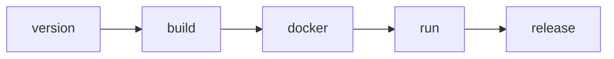

# gradle-hello-world

[](https://github.com/yarinkos/gradle-hello-world/actions/workflows/ci.yml)
[](https://github.com/yarinkos/gradle-hello-world/releases)
[](https://hub.docker.com/r/yarinkos/gradle-hello-world)

A Java Hello World built with Gradle, released by a GitHub Actions pipeline that
versions the jar, packages it in a Docker image and publishes it to Docker Hub.

```
$ docker run --rm yarinkos/gradle-hello-world
Hello World from Yarin!
```

## Basic usage

**Run the published image** (amd64 and arm64, including Apple Silicon Macs):

```bash
docker run --rm yarinkos/gradle-hello-world:latest
```

**Build and run locally.** Requires any JDK 17+; Gradle downloads JDK 21 for the build if it is missing.

```bash
./gradlew clean build                             # format check, compile, tests, jar
java -jar build/libs/gradle-hello-world-*-all.jar
```

**Build and run the Docker image locally:**

```bash
docker build --build-arg VERSION=1.0.0 -t gradle-hello-world .
docker run --rm gradle-hello-world
```

**Make a release.** Merge a pull request into `master`. The pipeline bumps the
patch version (`1.0.3` → `1.0.4`), builds, tests, pushes the image to Docker Hub,
pulls and runs it, then tags `v1.0.4` and publishes a GitHub Release with the jar.
Nothing is versioned by hand.

Everything below is detail.

---

## Exercise tasks

| Task | Where |
|---|---|
| 1. Fork | this repository, forked from `ido83/gradle-hello-world` |
| 2. Understand the repository | [Questions](#questions-task-2) |
| 3. Build with GitHub Actions | [`.github/workflows/ci.yml`](.github/workflows/ci.yml) |
| 4a. Name in the message | [`HelloWorld.java`](src/main/java/com/ido/HelloWorld.java) |
| 4b. Jar version 1.0.0 | tag `v1.0.0`; initial version in [`build.gradle.kts`](build.gradle.kts) |
| 5a. Auto-increment the patch | `version` job (axion-release) |
| 5b, 5c. Compile and package | `build` job |
| 5d. Build artifact | `build` job, `actions/upload-artifact` |
| 5e. Dockerfile, tagged with the jar version, non-root | [`Dockerfile`](Dockerfile), `docker` job |
| 5f. Push to Docker Hub | `docker` job |
| 5g. Download and run | `run` job |
| Bonus: multi-stage | [`Dockerfile`](Dockerfile): tests and packaging run inside the build stage |

## Questions (task 2)

**Which programming language is this?**
Java. The build script, `build.gradle.kts`, is written in Kotlin, but there is no
Kotlin application code.

**What is Gradle?**
A build automation tool for the JVM. It compiles code, resolves dependencies from
repositories such as Maven Central, runs tests and packages artifacts. Builds are
described in code (Kotlin or Groovy DSL) rather than XML, and plugins add
capabilities (here: `application`, `shadow` for the fat jar, `axion-release` for
versioning, `spotless` for formatting).

**How does Gradle work?**
A build runs in three phases:
1. **Initialization**: reads `settings.gradle.kts` to find the projects in the build.
2. **Configuration**: runs the build scripts and builds a graph of tasks and their
   dependencies (for example `build` → `check` → `test` → `compileJava`).
3. **Execution**: runs only the tasks the requested task needs, in dependency order.

Each task declares its inputs and outputs, so an unchanged task is skipped
(`UP-TO-DATE`) or restored from the build cache. That is why a second build is
much faster. A background daemon keeps a warm JVM between builds.

**What is the Gradle wrapper?**
`gradlew` / `gradlew.bat` plus `gradle/wrapper/`. It is a small launcher committed
to the repository that downloads the exact Gradle version named in
`gradle-wrapper.properties` and runs it. Nobody has to install Gradle, and every
developer and CI machine builds with the same version. Here it is also pinned with
a SHA-256 of the distribution, so a tampered download is rejected.

## Pipeline



| Job | Does | Runs on |
|---|---|---|
| `version` | axion reads the last `vX.Y.Z` tag and computes the next patch. Nothing is written yet. | PR + master |
| `build` | format check, compile, unit tests, fat jar, runs the jar, uploads it as an artifact | PR + master |
| `docker` | Trivy scans the Dockerfile and image, then builds amd64 + arm64 and pushes | PR (build only) + master |
| `run` | pulls the image back from Docker Hub, checks the exact output and that it does not run as root | master |
| `release` | tags `vX.Y.Z` and creates a GitHub Release with the jar attached | master |

- **Pull requests** build, test and build the image, but push, tag and release
  nothing. Their version stays a snapshot, e.g. `1.0.5-my-branch-SNAPSHOT`.
- **The tag is created last**, only after the image was pushed, pulled and run.
  A failed run leaves no tag, so the next run reuses the same version: no gaps.
- **One version, computed once.** Every job uses the `version` output, so the jar
  name, the image tag, the image label, the jar manifest and the git tag match.
- **Master runs are queued** (`concurrency`), so two merges can't both release the same version.
- **Optional arm64 run check.** The arm64 image is built and pushed on every run.
  To also run it on a native ARM runner: Actions → CI → Run workflow → `verify-arm64`,
  or `gh workflow run CI --ref master -f verify-arm64=true`.

## Versioning

The version is derived from git tags by the
[axion-release](https://github.com/allegro/axion-release-plugin) Gradle plugin.
It is not stored in any file.

| State | `./gradlew currentVersion` |
|---|---|
| on tag `v1.0.0` | `1.0.0` |
| one commit after it, on master | `1.0.1-SNAPSHOT` → released as `1.0.1` |
| on a branch | `1.0.1-my-branch-SNAPSHOT` |

`-PappVersion=X.Y.Z` overrides it. The Docker build uses this, because the build
context has no `.git` for axion to read; CI passes the version it computed.

## Docker image

- **Multi-stage.** The `build` stage (JDK 21) runs `./gradlew build`, so the
  format check and the unit tests run inside the image build. The runtime stage
  is `eclipse-temurin:21-jre-alpine` plus the jar: no JDK, Gradle or sources.
- **Non-root.** Fixed UID/GID `10001`. The jar is owned by root and read-only to that user.
- **Multi-arch.** One tag for `linux/amd64` and `linux/arm64`. The build stage runs
  on the build machine's own platform (`--platform=$BUILDPLATFORM`), so the jar is
  built once. Only the runtime stage's `RUN adduser` runs under QEMU for arm64, and
  with the GitHub Actions layer cache it is usually a cache hit.
- **Labelled** with `org.opencontainers.image.version`. `HEALTHCHECK NONE` is
  explicit: the container prints one line and exits.

## Security scanning

Trivy runs in the `docker` job **before** the push:

| Scan | Fails the job on |
|---|---|
| Dockerfile configuration | HIGH or CRITICAL misconfiguration |
| Image, gate | CRITICAL vulnerability that has a fix |
| Image, report | never: every finding goes to the repository's Security tab (SARIF) |

A vulnerable image never reaches Docker Hub. Unfixed CVEs are reported but don't
block, because rebuilding can't fix them. The security actions are pinned to commit SHAs.

## Local shortcuts

A `Makefile` wraps the same steps (`make` lists them):

```
make build          Format check, compile, unit tests and the fat jar
make test           Unit tests only
make format         Fix formatting (Spotless)
make run            Build and run the image locally
make verify         Build the image and check its output and non-root user, like CI
make pull-run       Pull the latest published image from Docker Hub and run it
make version        Print the version axion derives from git
```

## Repository structure

```
.
├── .github/workflows/ci.yml       the pipeline
├── src/main/java/com/ido/         HelloWorld.java
├── src/test/java/com/ido/         HelloWorldTest.java (JUnit)
├── build.gradle.kts               plugins, version, toolchain, tests, formatting
├── settings.gradle.kts            project name, JDK toolchain resolver
├── gradle/wrapper/                Gradle wrapper (pinned version + checksum)
├── Dockerfile                     multi-stage, non-root, multi-arch
├── Makefile                       local shortcuts
└── .dockerignore / .gitignore
```

## Design decisions

**Upgraded to Gradle 9 and Java 21.** The original Gradle 7.4.2 only runs on
JDK ≤ 17. Java 21 is the current LTS and is pinned with a toolchain. The unused
Kotlin and GraalVM plugins were removed, and `shadow` moved to its maintained
`com.gradleup.shadow` coordinates.

**axion-release rather than semantic-release or gradle-release.** The task asks
for a patch bump on every build, while semantic-release picks the bump from commit
messages (and brings Node into a Java project). The researchgate gradle-release
plugin keeps the version in a file and commits twice to master on every release.
axion only creates tags, so the history stays clean and CI never commits.
*Trade-off:* the version isn't visible in a file; `./gradlew currentVersion` shows it.

**Every merge is a release.** Each merged PR is one patch version, even a
docs-only change. Simple and predictable, at the cost of some versions with no
code change.

**The jar is built twice:** once by the `build` job (the artifact and the
Release asset) and once inside the Docker build stage (the multi-stage bonus).
Both build the same commit with the same version.

**Push before verify.** `run` checks the image after it is pushed, so if it fails,
Docker Hub holds an image for a version that was never tagged. The next run
overwrites that version, and the missing tag shows it was never released.

**Makefile rather than Docker Compose.** Compose orchestrates several long-running
services. This is one container that prints a line and exits.

**Tests and formatting.** JUnit tests check the exact message and that `main()`
prints it once. Spotless enforces import order, unused imports, indentation and
whitespace with rule-based steps rather than a full reformatter such as
google-java-format, which depends on JDK internals and tends to break on new JDKs.
